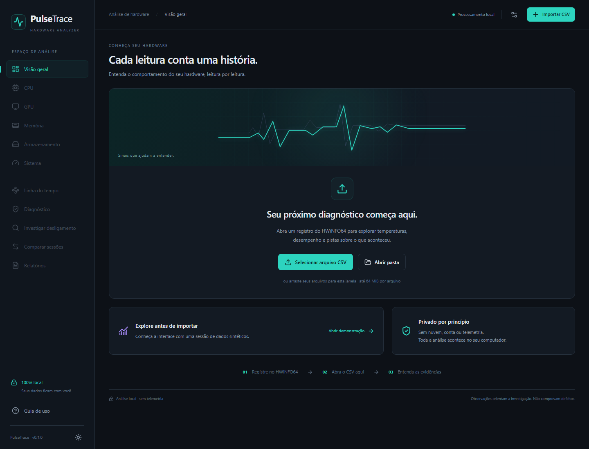
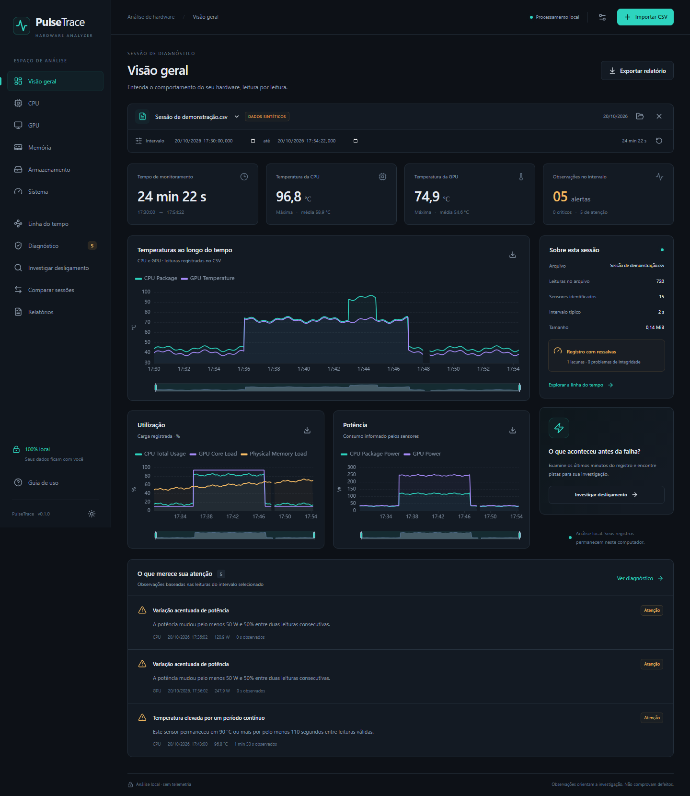

# PulseTrace

**Entenda o comportamento do seu hardware, leitura por leitura.**

PulseTrace é um analisador local de registros CSV do HWiNFO64. Ele reúne gráficos interativos, linha do tempo e observações fundamentadas para ajudar a investigar temperaturas elevadas, perda de desempenho, travamentos e desligamentos.

Não exige HWiNFO64 aberto durante a análise. Não utiliza nuvem, login, banco de dados, telemetria ou serviços pagos. O usuário do aplicativo empacotado não precisa instalar Python, Node.js ou Rust, nem usar terminal.

**Estado: implementação inicial 0.1.0, ainda não uma release Windows homologada.** Interface, núcleo e fluxos de navegador foram executados; build/execução nativos e instalador precisam de validação em ambiente com MSVC/Windows SDK. Não há release publicada nem assinatura digital configurada. Veja os resultados e limites em [Validação](docs/VALIDACAO.md).

## Interface

Capturas reais da interface React em execução no Chromium, feitas pelos testes Playwright. O dashboard usa a demonstração **sintética**, identificada na própria tela; não é uma captura do executável Tauri.





## Funcionalidades

- Dashboard com duração, horários, leituras, sensores, temperaturas, potência, alertas e integridade.
- Páginas CPU, GPU, Memória, Armazenamento e Sistema, conforme os sensores disponíveis.
- CSV único, múltiplos arquivos, pasta de registros e arrastar/soltar; progresso e cancelamento.
- Detecção de UTF-8, UTF-16 e Windows-1252; vírgula, ponto e vírgula ou tabulação.
- Colunas duplicadas preservadas; valores ausentes nunca preenchidos por suposição.
- Gráficos ECharts com zoom e intervalo compartilhado; seleção por teclado nos campos de data.
- Linha do tempo com alertas, lacunas, última leitura e marcadores manuais.
- Comparação de duas sessões e comparação de dois intervalos da mesma sessão.
- Diagnóstico determinístico, com gravidade, sensor, valor, horário, duração, hipóteses e limitações.
- Investigação dos minutos anteriores a uma falha e importação opcional de eventos Windows em JSON.
- PNG de cada gráfico, relatório HTML independente, PDF e dados filtrados em CSV.
- Português brasileiro, tema escuro padrão, tema claro e layout adaptável.

## Requisitos e instalação

O alvo de distribuição é **Windows 10/11 x64**, com Microsoft Edge WebView2 Runtime. Ainda é necessário validar o executável e a instalação nesses sistemas antes de publicar uma versão para usuários finais.

Quando uma release aprovada estiver disponível no GitHub Releases deste projeto:

1. Baixe o instalador `*-setup.exe` e o `SHA256SUMS.txt` da mesma release.
2. Execute o instalador para o usuário atual. Ele está configurado para incluir o instalador offline do WebView2.
3. Abra PulseTrace pelo menu Iniciar e importe um CSV.

O pacote ZIP sem instalador **depende de WebView2 já instalado**. Não é declarado independente nem validado em Windows limpo. Não há certificado configurado: não consideramos os binários assinados digitalmente. Nenhum instalador é incluído neste workspace enquanto a compilação nativa não for concluída.

Detalhes de compilação, artefatos, checksums e publicação manual: [Distribuição](docs/DISTRIBUICAO.md). Os requisitos de build seguem a [documentação oficial do Tauri](https://v2.tauri.app/start/prerequisites/); o modo offline do WebView2 está descrito no [guia de instaladores Windows](https://v2.tauri.app/distribute/windows-installer/).

## Como registrar sensores no HWiNFO64

1. Baixe o HWiNFO64 no [site oficial](https://www.hwinfo.com/download/). Escolha uma edição adequada ao seu uso e observe sua licença.
2. Abra o programa e selecione **Sensors-only** na janela inicial; inicie a janela de sensores.
3. Nas configurações da janela de sensores, confira o intervalo de leitura (**Sensor polling period** ou nome equivalente na versão instalada). **2.000 ms** é um ponto de partida; intervalos menores geram mais dados e intervalos maiores podem perder picos rápidos. Confira também eventual intervalo específico de logging oferecido pela sua versão.
4. Verifique que os sensores desejados estão sendo monitorados e habilitados para registro. A configuração de relatório geral não é a mesma coisa que registro de sensores. Essa diferença é esclarecida pelo autor do HWiNFO no [fórum oficial](https://www.hwinfo.com/forum/threads/hwinfo64-logging-question.8411/).
5. Use o botão **Start Logging / Iniciar registro** na barra inferior da janela de sensores; a aparência do ícone varia por versão. Selecione um arquivo `.csv` em uma pasta acessível, por exemplo `Documentos\HWiNFO Logs`.
6. Use o computador normalmente com o registro ativo. Para encerrar uma sessão normal, use **Stop Logging**. Evite sobrescrever um arquivo que você queira investigar depois.

O HWiNFO64 é software de terceiros, sujeito à própria licença e condições de uso. O PulseTrace não é afiliado ao HWiNFO e **não redistribui seus binários**.

## Abrir e interpretar um registro

Clique em **Importar CSV** ou arraste o arquivo para a janela. **Abrir pasta** importa CSVs como sessões independentes, sem juntar registros de dispositivos diferentes. No desktop a enumeração limita-se ao primeiro nível da pasta. Até três sessões podem ficar abertas; uma pasta com mais arquivos exige selecionar um subconjunto ou liberar sessões.

Antes de importar um arquivo de outro computador, abra **Opções de importação** no topo. Confira ordem da data (dia/mês ou mês/dia) e deslocamento em minutos de UTC. São Paulo sem horário de verão usa `-180`. Datas ISO com fuso explícito respeitam esse fuso. A interface usa o horário local deste computador; CSV exportado usa UTC.

Na visão geral, confira primeiro integridade, duração e sensores reconhecidos. Use o seletor inferior dos gráficos ou os campos de início/fim para examinar períodos. A seleção sincroniza os gráficos e os relatórios. Estatísticas da sessão e integridade referem-se ao arquivo completo quando assim identificadas; cards de temperatura usam o intervalo.

As classificações significam:

| Classificação | Como interpretar |
|---|---|
| Normal | Nenhum limiar das regras avaliadas foi atingido nas leituras disponíveis. Não comprova estabilidade. |
| Atenção | Uma observação merece contexto e verificações. |
| Crítico | Uma condição térmica persistente atingiu um limiar alto de triagem; confira o limite do fabricante. |
| Dados insuficientes | As leituras não sustentam uma conclusão. |

Em **Diagnóstico**, expanda cada observação para ver sensor, hipóteses, recomendações e confiança. As regras e limiares estão em [REGRAS.md](docs/REGRAS.md). Limites são genéricos; esta versão ainda não oferece perfis por modelo.

## Após um travamento ou desligamento

1. Reinicie o computador e preserve o CSV anterior. Não é preciso abrir o HWiNFO64 para analisá-lo.
2. Importe o arquivo e confira se o final coincide aproximadamente com o ocorrido.
3. Abra **Investigar desligamento**, informe o horário aproximado e escolha os minutos anteriores.
4. Confira a última leitura disponível, a distância até o horário informado, as lacunas e as observações.
5. Opcionalmente importe eventos Windows em JSON, seguindo [Eventos Windows](docs/EVENTOS-WINDOWS.md). A análise básica não exige administrador nem terminal.
6. Exporte um relatório se precisar guardar as evidências ou consultar suporte técnico.

Temperatura elevada não comprova componente defeituoso. Fim de CSV não comprova desligamento. Kernel-Power 41 não comprova defeito na fonte. Uso elevado de disco não comprova HD/SSD defeituoso. Ausência de throttling não comprova estabilidade térmica.

## Exportação e comparação

O botão de download de cada gráfico salva um PNG com o zoom atual. **Relatórios** oferece HTML independente, PDF paginado e CSV do intervalo, com unidades normalizadas e timestamps em UTC. HTML/PDF têm resumo técnico ou simplificado e incluem estatísticas e limitações; não incorporam imagens dos gráficos, marcadores ou eventos opcionais nesta versão.

Em **Comparar sessões**, selecione dois CSVs. Apenas sensores com identidade compatível são alinhados. Na **Linha do tempo**, fixe o intervalo A e altere a seleção para comparar com B. Cargas de trabalho diferentes não permitem comparar médias como se fossem um benchmark controlado.

## Limitações conhecidas

- Normalização em português/inglês e alguns aliases de data; não há cobertura universal de todos os idiomas, formatos ou versões do HWiNFO64.
- Um registro público externo foi validado. Isso não comprova compatibilidade com qualquer máquina ou CSV.
- Cabeçalhos sem identificação de dispositivo permanecem ambíguos. Duplicatas são preservadas por ocorrência; não se inventa identidade física.
- Limites: 64 MiB por arquivo, 4.096 colunas, 1 milhão de linhas, 6 milhões de valores por sessão, três sessões e 12 milhões de valores aceitos no total.
- Timestamps inválidos são descartados e contabilizados; linhas incompletas mantêm somente valores válidos. Não há interpolação de lacunas.
- Valores numéricos são armazenados em Float32; médias são aritméticas por amostra.
- Horário de verão histórico exige informar o deslocamento correto; não há inferência automática de timezone de um CSV sem fuso.
- Sessões, eventos e marcadores ficam em memória e não são restaurados ao fechar. Exporte antes de encerrar.
- Exportações grandes podem ocupar a interface. Não há captura ao vivo, reparo automático de hardware ou modificação de BIOS/drivers.
- PDF usa a fonte padrão do jsPDF, adequada ao português; caracteres fora do conjunto suportado podem não ser representados. HTML preserva Unicode.

## Desenvolvimento

Stack: Tauri 2, React, TypeScript estrito, Rust, Tailwind CSS 4, Apache ECharts, Vite, Vitest e Playwright. A estrutura está documentada em [Arquitetura](docs/ARQUITETURA.md).

Para executar a interface de desenvolvimento (Node.js 24):

```powershell
npm ci
npm run dev
```

Abra `http://127.0.0.1:1420`. A opção **Abrir demonstração** permite explorar dados sintéticos. O servidor Vite é apenas uma ferramenta de desenvolvimento local e não é usado no aplicativo distribuído.

Verificações:

```powershell
npm run check
npm run build
npx playwright install chromium
npm run test:e2e
```

Para desenvolver/empacotar o desktop, instale também Rust MSVC e Visual Studio C++ Build Tools com Windows SDK; veja [Distribuição](docs/DISTRIBUICAO.md).

```powershell
npm run desktop:dev
npm run desktop:build
./scripts/package.ps1
```

O workflow do GitHub Actions executa testes e prepara artefatos Windows e SHA-256. Ele **não publica releases**, não cria tags e não faz push.

## Privacidade e bugs

Os registros permanecem locais. Não há coleta ou envio automático. Relatórios só são gravados quando solicitados. Consulte a [política de privacidade](docs/PRIVACIDADE.md).

Ao reportar um bug nas Issues do repositório em que este projeto for hospedado, inclua versão do PulseTrace, Windows, versão do HWiNFO, idioma, delimitador, formato de data, passos e mensagem de erro. Anexe somente um trecho revisado/anônimo do CSV se necessário; não publique registros pessoais sem revisão. Para problemas de segurança, evite publicar arquivos exploráveis ou informações privadas e contate o responsável pelo repositório.
